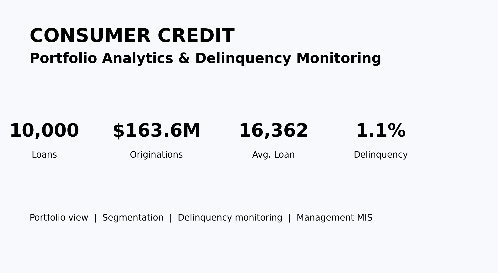
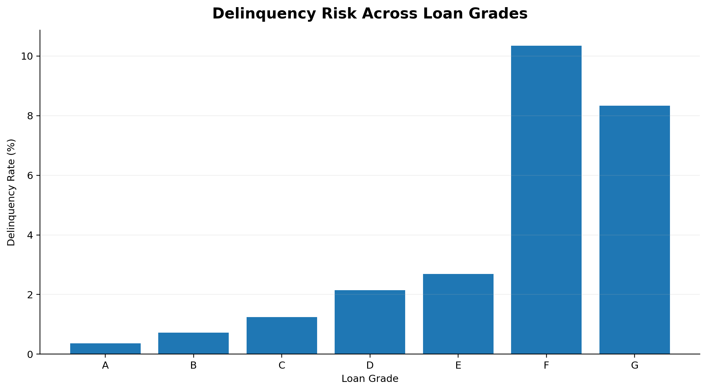
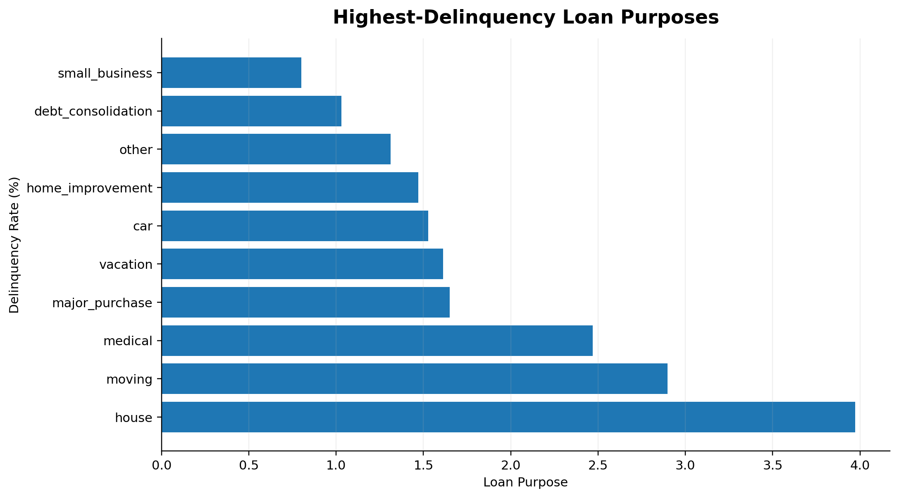
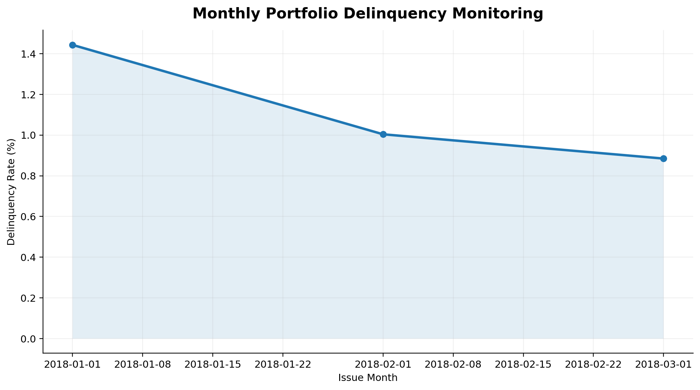
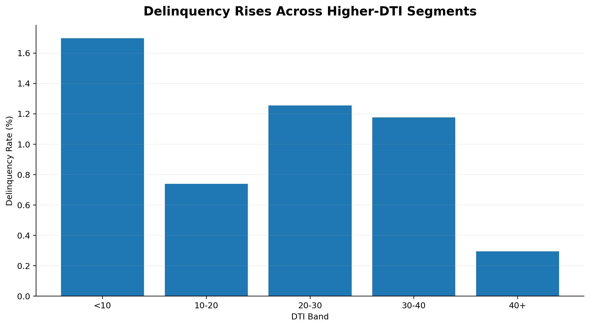
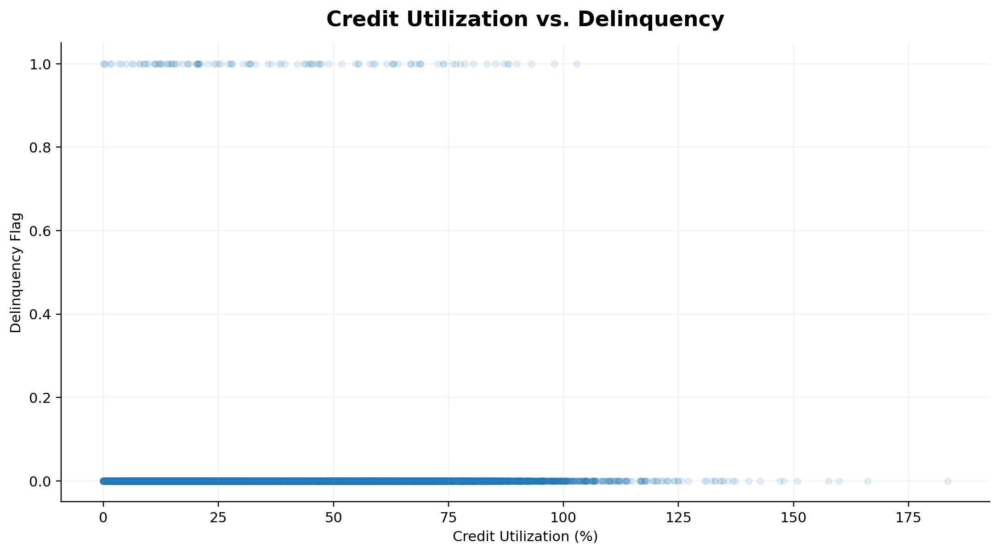
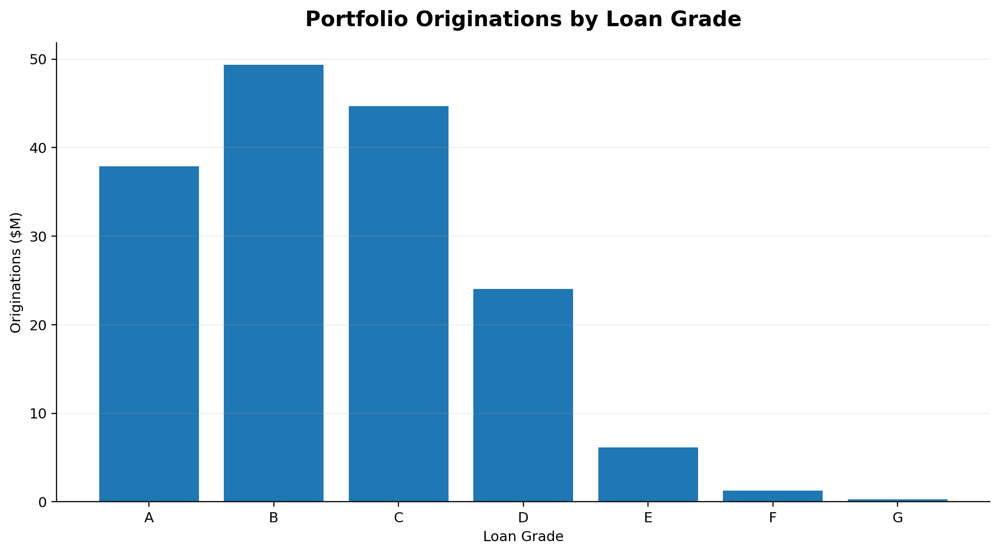
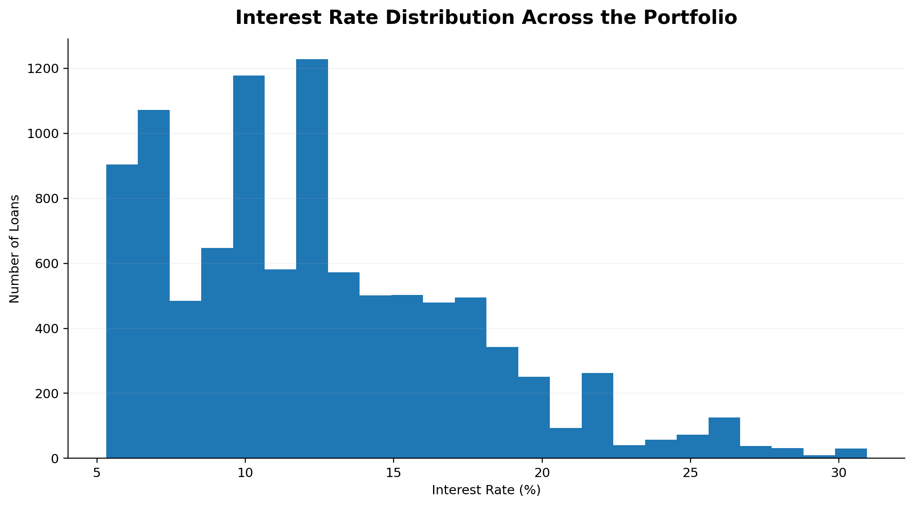
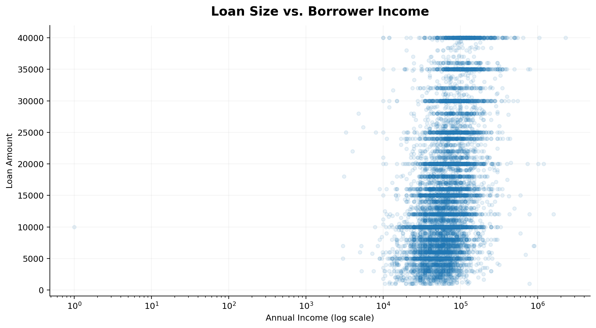

# 📊 Consumer Credit Portfolio Analytics & Delinquency Monitoring

<p align="center">
  <b>Portfolio Analytics • Delinquency Monitoring • SQL • Python • Excel MIS</b>
</p>

<p align="center">
  
  
  
  
</p>

---

## 🎯 Project Overview

**Consumer Credit Portfolio Analytics & Delinquency Monitoring** is a data analytics project focused on understanding portfolio performance, identifying delinquency patterns, segmenting borrowers, and creating management-ready monitoring outputs.

Rather than building another standalone credit-risk prediction model, this project focuses on the **portfolio monitoring perspective**:

> **How is the portfolio performing, where is delinquency concentrated, and which segments require closer monitoring?**

---

## 📌 Portfolio Snapshot

| Metric | Value |
|---|---:|
| 💳 **Loans Analysed** | **10,000** |
| 💰 **Total Originations** | **$139.7M** |
| 🏦 **Average Loan Amount** | **$13,970** |
| 📈 **Average Interest Rate** | **13.5%** |
| 📊 **Average DTI** | **17.7** |
| ⚠️ **Portfolio Delinquency Rate** | **14.8%** |

<p align="center">
  
</p>

---

## 💡 Business Questions

The analysis was designed around practical portfolio-monitoring questions:

| Business Question | Analytical Approach |
|---|---|
| How healthy is the overall portfolio? | Executive portfolio KPIs |
| Which loan grades show higher delinquency? | Grade-level segmentation |
| Which loan purposes have higher risk? | Purpose-level monitoring |
| Does borrower leverage relate to delinquency? | DTI segmentation |
| Does credit utilization show a risk relationship? | Utilization analysis |
| How does portfolio performance change over time? | Monthly monitoring |
| Where is portfolio exposure concentrated? | Originations by grade |
| How do borrower characteristics relate to loan size? | Income vs. loan analysis |

---

# 🔎 Portfolio Analytics

## 1️⃣ Delinquency Across Loan Grades

Loan grades provide a useful portfolio segmentation framework for comparing delinquency levels across different credit-quality categories.

<p align="center">
  
</p>

### Key takeaway

The analysis allows portfolio managers to identify grades where delinquency is comparatively elevated and prioritize those segments for closer monitoring.

---

## 2️⃣ Delinquency by Loan Purpose

Different loan purposes can exhibit different borrower and repayment characteristics.

<p align="center">
  
</p>

### Key takeaway

Purpose-level monitoring helps identify segments with comparatively higher delinquency exposure and provides an additional dimension for portfolio segmentation.

---

## 3️⃣ Monthly Delinquency Monitoring

Monitoring delinquency over time helps identify changes in portfolio performance across loan vintages.

<p align="center">
  
</p>

### Key takeaway

Monthly monitoring can be used as an early-warning view of changing portfolio performance and emerging risk patterns.

---

## 4️⃣ DTI Segmentation

Debt-to-income ratio is an important borrower-level indicator of financial leverage.

<p align="center">
  
</p>

### Key takeaway

Segmenting borrowers by DTI helps identify whether higher borrower leverage is associated with elevated delinquency rates.

---

## 5️⃣ Credit Utilization vs. Delinquency

Credit utilization provides another view of borrower credit exposure.

<p align="center">
  
</p>

### Key takeaway

The analysis provides a visual view of the relationship between credit utilization and observed delinquency outcomes.

---

# 💰 Portfolio Composition

## 6️⃣ Originations by Loan Grade

Understanding where portfolio exposure is concentrated is important for portfolio-level risk monitoring.

<p align="center">
  
</p>

### Key takeaway

Grade-level originations show how portfolio exposure is distributed across credit-quality segments.

---

## 7️⃣ Interest Rate Distribution

<p align="center">
  
</p>

Interest-rate distributions provide an overview of pricing across the loan portfolio and can be used alongside delinquency segmentation for portfolio monitoring.

---

## 8️⃣ Loan Amount vs. Borrower Income

<p align="center">
  
</p>

### Key takeaway

Comparing loan size with borrower income helps provide context around borrower exposure and portfolio composition.

---

# 🧰 Technology Stack

### 🐍 Python
- Pandas
- NumPy
- Matplotlib
- Exploratory Data Analysis
- Data Cleaning
- Portfolio Segmentation
- Statistical Analysis
- Data Visualization

### 🗄️ SQL
- Portfolio KPI calculations
- Aggregations
- Segmentation
- Delinquency monitoring
- Window functions
- High-value/high-risk portfolio analysis

### 📊 Microsoft Excel
- Management Information System (MIS)
- Portfolio KPI reporting
- Grade analysis
- Purpose analysis
- Monthly monitoring
- DTI segmentation

---

# 🗃️ SQL Analytics

The SQL component translates the portfolio into business-monitoring queries.

### Examples include:

**Executive KPIs**
```sql
SELECT
    COUNT(*) AS total_loans,
    SUM(loan_amount) AS total_originations,
    AVG(loan_amount) AS avg_loan_amount,
    AVG(interest_rate) AS avg_interest_rate,
    AVG(debt_to_income) AS avg_dti,
    AVG(delinquency_flag) * 100 AS delinquency_rate_pct
FROM portfolio_analysis_data;
